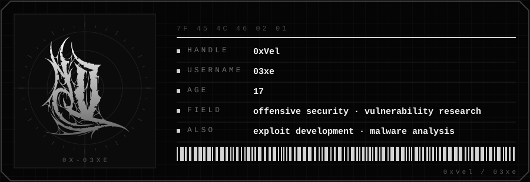

 
      

 

 

 
## ▌ WHO THE FUCK AM I? you might ask
 
I'm V. Offensive security and vulnerability research, with exploit development and malware analysis next to it (Holy fuck I do a lot of things).
 
I'm a perfectionist.
 
I'll probably import all of my projects from my other acc later.
 

## ▌ WHAT I DO
 
| Includes | ? |
|:--|:--|
| **offensive security** | vulnerability research, exploit development, attack-surface analysis. |
| **reverse engineering** | disassembly, debugging, static and dynamic analysis. |
| **malware analysis** | behavior and structure analysis of binaries. |
| **How I learn** | I break things to understand and learn so uhm sorry bro (Not sorry.) |
 

## ▌ PROJECTS
 
> slots are empty on purpose. stuff goes here when it's perfect for use.
 
| `slot_01` | `slot_02` |
|:--|:--|
| `[ LOCKED ]` | `[ LOCKED ]` |
| `slot_03` | `slot_04` |
| `[ LOCKED ]` | `[ LOCKED ]` |
 

## ▌ STATS
 

 
 

## ▌ CONTACT
 
[`github.com/03xe`](https://github.com/03xe) · `Discord: @03xe` · 
 

 
